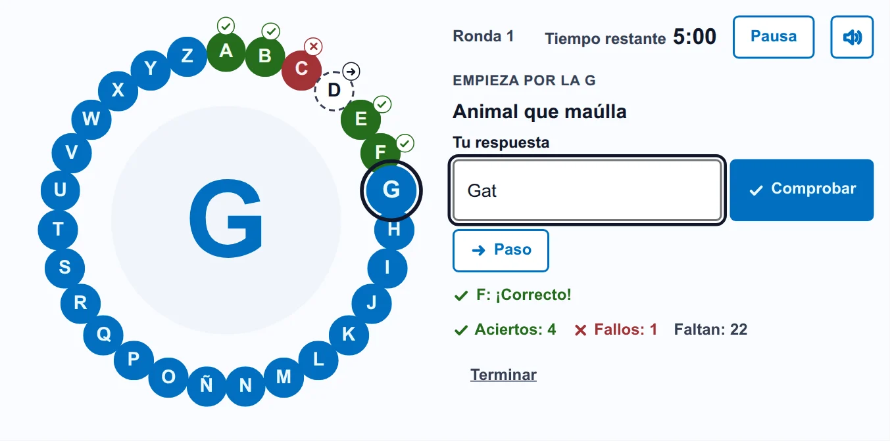
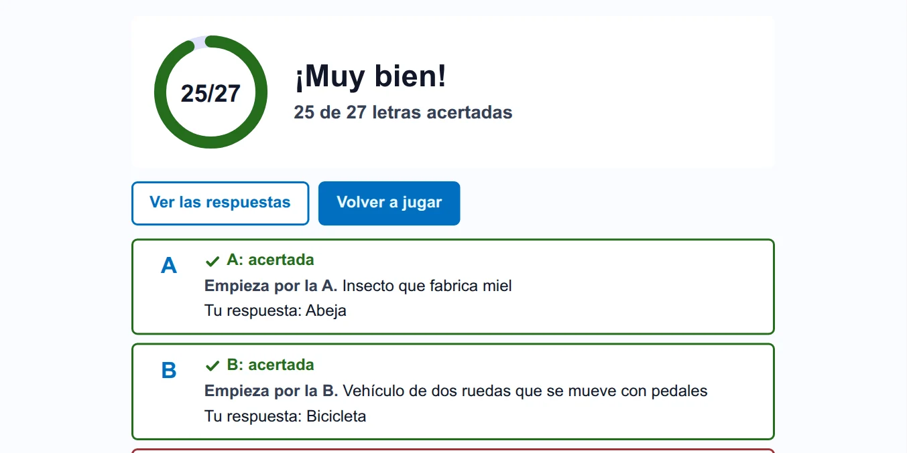
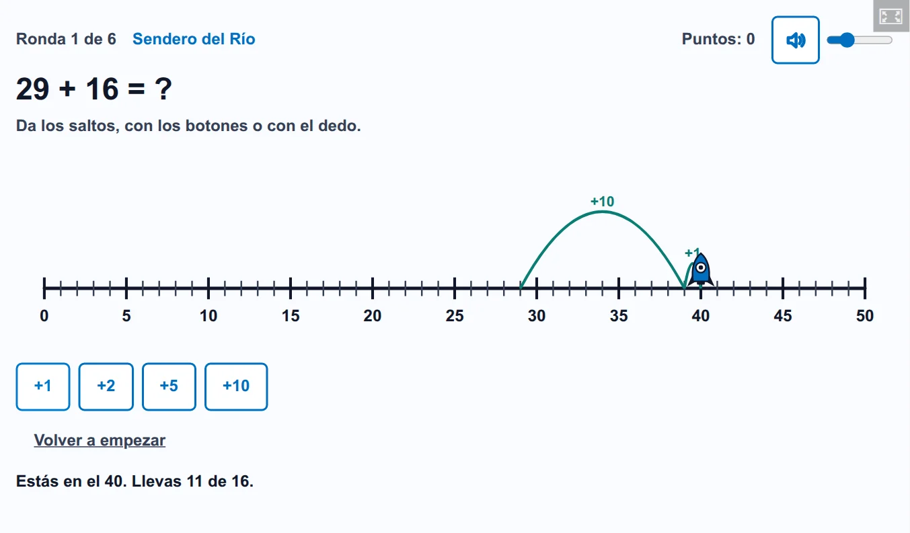

# Juegos de Oksigenia para H5P

[](LICENSE)
[](https://github.com/OksigeniaSL/h5p-oksigenia/releases)
[](https://oksigenia.com/en/open-source#sponsor)

Juegos convertidos en tipos de contenido H5P. Cada alumno juega solo, el juego corrige y la nota llega al
libro de calificaciones: en Moodle™ cuenta como una actividad calificada, igual que cualquier otra actividad H5P.

[Read in English](README.md)

<picture>
  <source media="(prefers-color-scheme: dark)" srcset="docs/img/alphabet-wheel-game-es-dark.webp">
  
</picture>

**[Juega ahora](https://campus.oksigenia.com/local/oksigeniacampus/demo.php?as=alumno&course=DEMO-AULA&to=%2Fmod%2Fh5pactivity%2Fview.php%3Fid%3D19)** en un aula de demostración, con un clic y sin registrarte, o
[descárgala](https://github.com/OksigeniaSL/h5p-oksigenia/releases/latest) con un ejemplo en tu idioma.

## Juegos

- **Rueda de letras** (`H5P.AlphabetWheel`): una pista por cada letra del alfabeto. El alumno escribe la respuesta o
  pasa la letra a la siguiente vuelta. Un punto por letra. Al terminar, el alumno ve su nota y cómo le fue en cada letra,
  y el docente tiene cada intento en el informe de la actividad.

  

- **Recta numérica** (`H5P.NumberLine`): sumas, restas, tablas, números y fracciones como saltos en una recta. Los saltos
  son la respuesta, no una pregunta antes de saltar: no hay reloj, y un intento fallido enseña dónde ha caído. Cada
  partida genera sus números, así que el docente solo elige qué se practica, o deja la elección para la primera pantalla.
  Cada ronda queda en el informe de la actividad. Hay tres piezas a elegir, para que no resulte infantil a ninguna edad, y
  una recta libre, sin puntos, para la pizarra. **[Juega ahora](https://campus.oksigenia.com/local/oksigeniacampus/demo.php?as=alumno&course=DEMO-AULA&to=%2Fmod%2Fh5pactivity%2Fview.php%3Fid%3D78)**.

  <picture>
    <source media="(prefers-color-scheme: dark)" srcset="docs/img/number-line-game-es-dark.webp">
    
  </picture>

## Idiomas

Inglés, español, alemán, francés, italiano, neerlandés, portugués de Brasil y sueco, tanto para quien juega como para
quien crea el contenido en el editor de H5P, y cada uno con su ejemplo. En la Rueda, las respuestas se corrigen con las reglas
de su idioma: la Ñ, la Ä o la Å nunca cuentan como otra letra.

## Dónde funcionan

En cualquier plataforma con H5P: la actividad H5P de Moodle 4.5 o posterior, WordPress con el plugin de H5P y Lumi
Desktop. Los juegos no dependen del núcleo H5P 1.28, así que también se instalan en sitios con el núcleo 1.27.

Cada versión publicada trae un `.h5p` de ejemplo por idioma. La [guía para administradores](docs/guia-administradores.md) explica la instalación, los permisos y la nota. Al subirlo, el juego queda instalado en el sitio. Para
eso hace falta un usuario con permiso para instalar tipos de contenido H5P (en Moodle, el permiso
`moodle/h5p:updatelibraries`).

## Accesibilidad

La partida entera se juega con el teclado. La letra, la pista y el resultado se anuncian al lector de pantalla, nada
depende solo del color, el temporizador se puede pausar y todo se ve bien a 320 px de ancho y con zoom al 200 %.

## Desarrollo

Una carpeta por librería H5P en `packages/` y, en `packages/shared/`, el código que comparten los juegos, que se
compila dentro de cada juego en vez de instalarse como una librería más. Cada juego se publica por separado, con una
etiqueta como `alphabet-wheel-v1.0.0` y sus `.h5p` de ejemplo. Hace falta Node 22 o posterior.

```
npm install
npm test             # pruebas unitarias
npm run typecheck    # tipos, a partir de los comentarios JSDoc
npm run dev          # el servidor de pruebas de H5P (h5p-cli) con todos los juegos y sus ejemplos
npm run e2e          # pruebas de extremo a extremo en un navegador contra ese servidor
npm run pack         # build/ con cada librería y dist/ con los .h5p de ejemplo
npm run lang         # language/*.json a partir de semantics.json y de los diccionarios de i18n/
```

Las mismas fuentes dan siempre el mismo `.h5p`, byte a byte.

En plataformas reales, con datos de ejemplo y sitios de usar y tirar que se borran al acabar (Docker, con tope de
memoria y de CPU):

```
tests/platforms/moodle/run.sh 4.5     # o 5.3: intentos, notas y reanudación en la actividad H5P de Moodle
tests/platforms/wordpress/run.sh      # el plugin oficial de H5P: instalación, resultados y reanudación
node tests/platforms/lumi/check.mjs   # el motor H5P de Lumi Desktop 1.0.3, con el núcleo 1.27
```

## En la pizarra de clase

Los mismos juegos, para toda la clase a la vez y con el docente llevando la cuenta, están en
[Oksigenia Classtools](https://github.com/OksigeniaSL/moodle-local_oksigeniaclasstools), la pizarra de aula para
Moodle.

## Licencia

MIT. © 2026 Oksigenia SL.

H5P es una marca registrada de H5P Group. Moodle™ es una marca registrada de Moodle Pty Ltd en muchos países.
