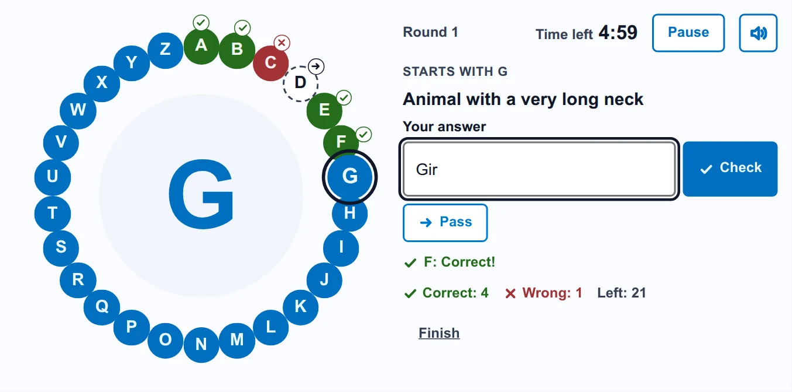
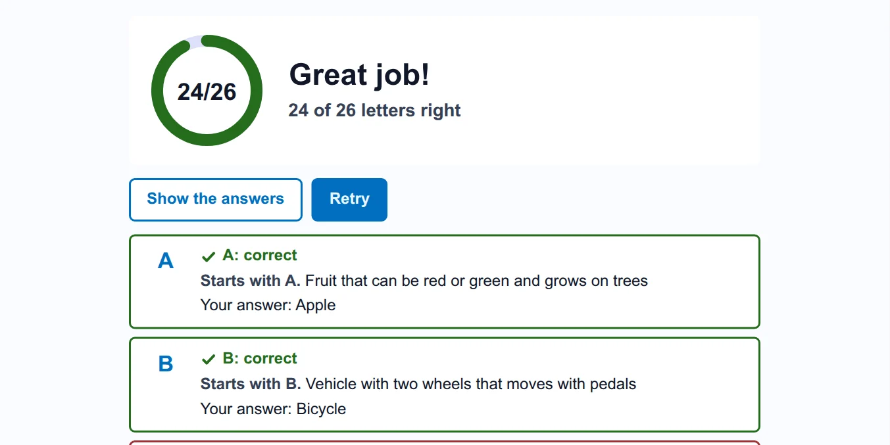
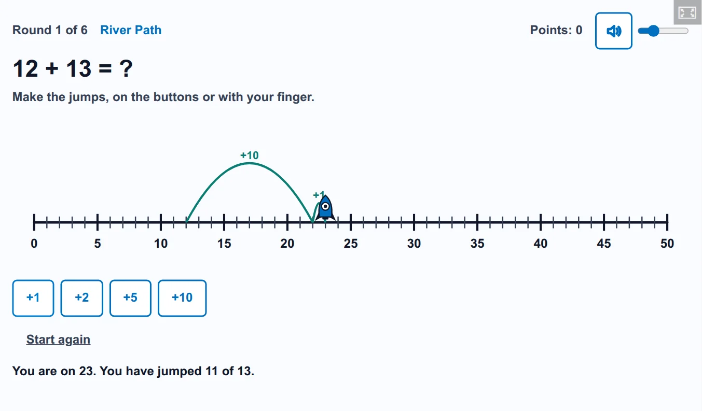
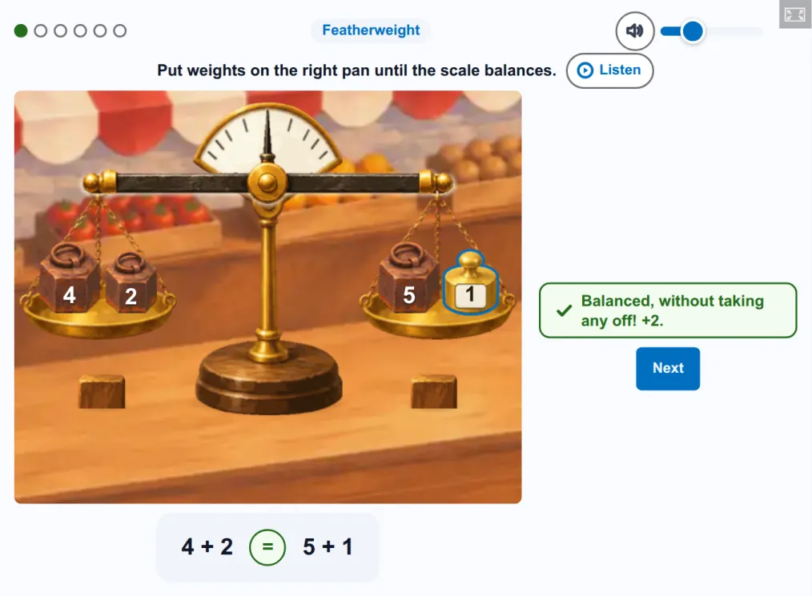

# Oksigenia games for H5P

[](LICENSE)
[](https://github.com/OksigeniaSL/h5p-oksigenia/releases)
[](https://oksigenia.com/en/open-source#sponsor)

Games as H5P content types. Each student plays on their own, the game checks the answers and the score goes
to the gradebook, so a game counts as a graded activity in Moodle™ like any other H5P activity.

[Leer en español](README.es.md)

<picture>
  <source media="(prefers-color-scheme: dark)" srcset="docs/img/alphabet-wheel-game-dark.webp">
  
</picture>

**[Play it now](https://campus.oksigenia.com/local/oksigeniacampus/demo.php?as=alumno&course=DEMO-AULA&to=%2Fmod%2Fh5pactivity%2Fview.php%3Fid%3D19)** in a demo classroom in Spanish, with one click and no sign-up, or
[download it](https://github.com/OksigeniaSL/h5p-oksigenia/releases/latest) with an example in your language.

## Games

- **Alphabet Wheel** (`H5P.AlphabetWheel`): a clue for each letter of the alphabet, in words, in a picture or both. The
  student types the answer or passes the letter to the next round. One point per letter. At the end, the student sees the score and how each letter
  went, and the teacher has every attempt in the report of the activity.

  

- **Number Line** (`H5P.NumberLine`): addition, subtraction, times tables, whole numbers and fractions as jumps on a
  number line. The jumps are the answer, not a question before them: there is no clock, and a wrong try shows where it
  landed. Each game makes up its own numbers, so the teacher only chooses what to practise, or leaves the choice for the
  first screen. Every round goes to the report of the activity. There are three pieces to choose from, so it does not feel
  childish at any age, and a free line with no points, for a board. **[Play it now](https://campus.oksigenia.com/local/oksigeniacampus/demo.php?as=alumno&course=DEMO-AULA&to=%2Fmod%2Fh5pactivity%2Fview.php%3Fid%3D78)**, in Spanish.

  <picture>
    <source media="(prefers-color-scheme: dark)" srcset="docs/img/number-line-game-dark.webp">
    
  </picture>

- **Balance Scale** (`H5P.BalanceScale`): equalities on a two-pan balance. What is put on the scale is
  the answer, and the equality is written under it with =, < or >: sums with the gap on either side, equal groups
  (multiplying and dividing), sharing out every weight and a mystery bag. By default the scale leans at once, which is
  what works best in studies with on-screen balances; it can also be held until it is let go. Each game makes up its own
  numbers, a round that goes wrong comes back later with other numbers, and every round goes to the report of the
  activity. Three painted scales to choose from (a market, a laboratory and a pencil drawing on squared paper), the
  instructions recorded in Spanish and English, and a free balance with no points, for a board.
  **[Play it now](https://campus.oksigenia.com/local/oksigeniacampus/demo.php?as=alumno&course=DEMO-AULA&to=%2Fmod%2Fh5pactivity%2Fview.php%3Fid%3D79)**, in Spanish.

  <picture>
    <source media="(prefers-color-scheme: dark)" srcset="docs/img/balance-scale-game-dark.webp">
    
  </picture>

## Languages

English, Spanish, German, French, Italian, Dutch, Portuguese (Brazil) and Swedish, both for players and for authors
in the H5P editor, each with an example. In the Alphabet Wheel, answers are checked by the rules of their own language:
the Ñ, the Ä or the Å never count as another letter.

## Where they run

Anywhere H5P runs: the H5P activity of Moodle 4.5 or later, WordPress with the H5P plugin, and Lumi Desktop. The
games do not depend on H5P core 1.28, so they also install on sites with core 1.27.

Each release comes with an example `.h5p` per language; [the guide for administrators](docs/guia-administradores.md), in Spanish, explains installation, permissions and grading. Uploading it installs the game on the site; that needs a
user allowed to install H5P content types (in Moodle, the capability `moodle/h5p:updatelibraries`).

## Accessibility

The whole game is played with the keyboard, the letter, the clue and the result are announced to screen readers,
nothing relies on colour alone, any timer can be paused, and the layout works at 320 px wide and at 200 % zoom.

## Development

One folder per H5P library in `packages/`, and the code the games share in `packages/shared/`, built into each
game rather than shipped as a library of its own. Each game is released on its own, with a tag such as
`alphabet-wheel-v1.0.0` and its example `.h5p` files. Node 22 or later.

```
npm install
npm test             # unit tests
npm run typecheck    # types, from the JSDoc comments
npm run dev          # the H5P dev server (h5p-cli) with every game and its examples
npm run e2e          # end-to-end tests in a browser against that server
npm run pack         # build/ with each library and dist/ with the example .h5p files
npm run lang         # language/*.json from semantics.json and the dictionaries in i18n/
```

The same sources always give the same `.h5p`, byte for byte.

On real platforms, with example data and throwaway sites that are removed at the end (Docker; memory and CPU
capped):

```
tests/platforms/moodle/run.sh 4.5     # or 5.3: attempts, grades and resume in the H5P activity of Moodle
tests/platforms/wordpress/run.sh      # the official H5P plugin: install, results and resume
node tests/platforms/lumi/check.mjs   # the H5P engine of Lumi Desktop 1.0.3, on core 1.27
```

As a classroom board shows them: whole at 1280×600, 960×540, 1366×768, 1517×717 and 1115×555, a sudden change of size in the
middle of a game, and full screen; with `--old`, also with the styles that the old browser of some boards (Firefox 98) keeps.
The same in that browser itself, in a container and outside an LMS, with `firefox98.mjs` (how to start it, at the top of the
file). Inside Moodle 5.3 that browser shows no H5P content and sends no results, whatever the content: the scripts of Moodle's
embed page need import maps, which arrive in Firefox 108. Moodle 4.5 works.

```
node tests/boards/boards.mjs [--old]
node tests/boards/firefox98.mjs
```

## On the classroom board

The same games for the whole class at once, with the teacher keeping score, are in
[Oksigenia Classtools](https://github.com/OksigeniaSL/moodle-local_oksigeniaclasstools), the classroom board for
Moodle.

## License

MIT. © 2026 Oksigenia SL.

H5P is a registered trademark of H5P Group. Moodle™ is a registered trademark of Moodle Pty Ltd in many countries.
